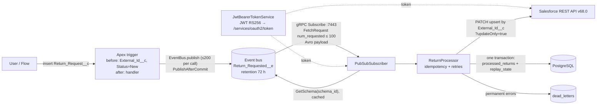

# sf-returns-sync-java

Salesforce ↔ Java integration without MuleSoft: Platform Events over the **Pub/Sub API (gRPC + Avro)**,
idempotent processing, dead letters, retries of transient errors only, and the result written back to
Salesforce with a **REST upsert by External ID** (`updateOnly=true`).

It is a portfolio project. The goal is to show the same job a MuleSoft Salesforce Pub/Sub Connector flow does,
written by hand, small enough to explain line by line in an interview.

> **Status — read this first.** The service builds and all tests pass (`mvn verify`, CI). It has **not been run
> against a live Salesforce org** yet, and memory under real load is **not measured** yet.
> See [What is verified and what is not](#what-is-verified-and-what-is-not).

## What it does

1. A `Return_Request__c` record is created in Salesforce (UI, Flow, API).
2. A thin Apex trigger fills `External_Id__c` / `Status__c = New` and publishes `Return_Requested__e`
   (High Volume, Publish After Commit) with one `EventBus.publish` per trigger batch.
3. The Java service subscribes via the Pub/Sub API (`api.pubsub.salesforce.com:7443`), decodes the Avro payload,
   decides `Approved` / `Rejected` / `Manual_Review`, and calls
   `PATCH /services/data/v68.0/sobjects/Return_Request__c/External_Id__c/{id}?updateOnly=true`.
4. The result and the replay ID are committed in **one PostgreSQL transaction**. Permanent errors go to
   `dead_letters` (also together with the replay ID). Transient errors are retried, then the stream restarts
   from the last saved replay ID.

## Architecture



```
sf-returns-sync-java/
├── salesforce/                      SFDX project
│   └── force-app/main/default/
│       ├── objects/Return_Request__c/      External_Id__c (External ID, unique), Status__c, Order_Number__c, Amount__c
│       ├── objects/Return_Requested__e/    HighVolume, PublishAfterCommit
│       ├── triggers/ReturnRequestTrigger   thin trigger
│       ├── classes/ReturnRequestTriggerHandler(+Test)   bulk test on 200 records
│       └── permissionsets/Return_Sync_Integration
├── service/                         Maven, Spring Boot 4.1, Java 25
│   ├── src/main/proto/pubsub_api.proto      copy from forcedotcom/pub-sub-api (CC0), byte-identical
│   └── src/main/java/io/github/albert/returnsync/
│       ├── auth/        JwtBearerTokenService, SalesforceToken
│       ├── pubsub/      PubSubSubscriber, SalesforceCallCredentials
│       ├── processing/  ReturnEvent, ReturnPolicy, ReturnProcessor
│       ├── salesforce/  SalesforceRestClient, Transient/PermanentSalesforceException
│       ├── store/       ReturnStore (JdbcClient, Flyway migration V1__init.sql)
│       └── config/      SalesforceProperties
├── docker-compose.yml               postgres:17-alpine + service (mem_limit 384m)
└── .github/workflows/ci.yml         mvn verify, docker smoke run, Apex validation
```

No `interface` + `Impl`, no mappers, no DTO layers: nine production classes in five packages.

## Built on the official sample

Salesforce officially supports only the Java samples of the Pub/Sub API: the *Java Quick Start* and the `java`
folder of [`forcedotcom/pub-sub-api`](https://github.com/forcedotcom/pub-sub-api). The repository is archived
(read-only), but the docs still point to it. Taken from it as is:

- `pubsub_api.proto` and stub generation by the Maven protobuf plugin during the build;
- the `StreamObserver` pull subscription, the next `FetchRequest` when `pending_num_requested == 0`;
- replay ID as `ByteString` / bytes, presets LATEST / CUSTOM / EARLIEST;
- `GetSchema` by `schema_id` + a schema cache (`ConcurrentHashMap`), Avro `GenericRecord`;
- auth metadata `accessToken` / `instanceUrl` / `tenantId` on every call (`APISessionCredentials.java`);
- error handling via the `error-code` trailer: `fetch.replayid.corrupted` / `fetch.replayid.validation.failed` → EARLIEST.

Added on top (what a sample skips and a production service needs): OAuth 2.0 JWT Bearer instead of
username/password, replay ID in PostgreSQL instead of process memory, idempotency, dead letters, retries of
transient errors only, one transaction "result + replay ID", `SmartLifecycle` with graceful shutdown,
reconnect with backoff + jitter, Docker, CI, tests.

## Integration patterns covered

Names from Salesforce *[Integration Patterns and Practices](https://developer.salesforce.com/docs/atlas.en-us.integration_patterns_and_practices.meta/integration_patterns_and_practices/integ_pat_intro_overview.htm)*
(checked against the Winter '27, v68.0 PDF):

- **Remote Process Invocation — Fire and Forget**, process-driven platform events: Salesforce publishes and does
  not wait. The guide: platform events are published once, there is no retry on the Salesforce side, the
  subscriber requests a replay, and "the replay ID remains the same", so duplicates can be detected.
- **Remote Call-In**: the external service updates Salesforce through the REST API.
- **Idempotent design.** This is *not* a separately named pattern in the guide. Each pattern has an
  "Idempotent Design Considerations" section; Request and Reply says "the most typical method of building an
  idempotent receiver is for it to track duplicates based on unique message identifiers" and recommends an
  upsert. *Idempotent Receiver* as a pattern name comes from Hohpe & Woolf, *Enterprise Integration Patterns*.
  Here: at-least-once delivery + dedup on `External_Id__c` (`processed_returns`) + the upsert itself is
  idempotent (same status for the same External ID). The dedup key is the business key, not the replay ID,
  so a re-published event for the same request is also caught.

## Protocol rules and where the code enforces them

| Rule (Pub/Sub API docs) | Where |
|---|---|
| `num_requested` ≤ 100 | `SalesforceProperties` rejects `batch-size` outside 1..100 at startup; default 25 |
| After `pending_num_requested == 0`, send a new `FetchRequest` within 60 s | `PubSubSubscriber.handle` sends it **before** processing the batch, so the deadline doesn't depend on REST latency |
| Keepalive (empty `FetchResponse`) carries `latest_replay_id`: store it | `handle` → `ReturnStore.saveReplayId` |
| Replay ID is opaque bytes | `BYTEA` column, `ByteString` end to end, never converted |
| Replay option is read only in the first `FetchRequest` of a stream | `subscribe()`: CUSTOM with stored ID, else LATEST |
| Replay ID older than 72 h or corrupted (`...replayid...` error code) | next subscribe uses EARLIEST; idempotency drops the duplicates |
| `...auth.error` / `UNAUTHENTICATED` | drop the cached token, reconnect, a new JWT is signed |
| Any stream error → call `Subscribe` again | `reconnectLater()`: backoff 1 s → 64 s cap + jitter; a `generation` counter ignores callbacks of old streams |

## Design decisions & trade-offs

- `Subscribe` + client-side replay store instead of `ManagedSubscribe` (beta): with plain `Subscribe` the replay
  store is the client's responsibility, which is exactly the part worth showing.
- **One worker thread.** gRPC calls `onNext` on its network thread, which must not block; everything goes to
  `pubsub-worker`. Strict ordering, and only one thread touches the request `StreamObserver` (it is not thread-safe).
- **Next `FetchRequest` before processing.** The official sample notes this for slow processing. At most one
  extra batch waits in the worker queue (the next request is only sent when the worker gets to a response).
  If one batch ever takes longer than 60 s, the server closes the stream and the service resumes from the stored
  replay ID — slower, not lossy.
- **REST call outside the DB transaction**; result + replay ID in one transaction (`@Transactional` on a public
  method of a separate bean, so the proxy works).
- **Retries only for transient errors**: 429, 5xx, I/O, `REQUEST_LIMIT_EXCEEDED`, and a 401 that survives one token
  refresh (a credentials problem is not the message's fault; it must not dead-letter every event). 3 attempts,
  0.5 s → 1 s. After that the stream restarts from the last saved replay ID: events stay on the bus for 72 h.
- **Permanent errors** (e.g. 404, unknown External ID with `updateOnly`) → `dead_letters` + replay ID advances.
- **Poison messages**: an event whose Avro payload can't be decoded goes to `dead_letters` instead of restarting
  the stream forever. A failure to *fetch* the schema is transient and restarts the stream.
- `REQUEST_LIMIT_EXCEEDED` (15,000 REST calls / 24 h in Developer Edition) is treated as transient. Retries won't
  fix it quickly, but the replay ID doesn't move and the backoff grows, so nothing is lost within 72 h.
- `tenantid` = org ID, parsed from the `id` URL of the token response. A common approach; the JWT article doesn't
  spell it out. Alternative: call the identity URL.
- JDK `HttpClient` instead of Spring `RestClient`, JDK `Signature` instead of Nimbus/jjwt: no extra dependencies,
  and the JWT code follows the Help article step by step (~30 lines).
- No web server, no JPA, no Kafka, no Resilience4j: three tables and one stream don't need them.

## Limits considered (Developer Edition)

From the official *Platform Events Developer Guide* and *Salesforce Developer Limits and Allocations Quick
Reference*, v68.0 (Winter '27):

| Limit | Value | How the design respects it |
|---|---|---|
| Event delivery to Pub/Sub API / CometD / empApi / relays | 10,000 / 24 h (rolling, shared by all API subscribers; Apex triggers and flows don't count) | small org volume; one subscriber |
| Event publishing | 50,000 / hour | one `EventBus.publish` per trigger batch |
| REST API requests | 15,000 / 24 h (Total Calls Per 24-Hour Period) | one PATCH per return; no polling |
| High-volume event retention | 72 h | replay store; EARLIEST fallback |
| `num_requested` | ≤ 100 | 25 |
| Next `FetchRequest` | within 60 s after pending = 0 | sent before processing |
| Keepalive | ≤ 270 s | replay ID from empty responses is saved |

## How this maps to MuleSoft

| This repo | MuleSoft |
|---|---|
| `PubSubSubscriber` | Salesforce Pub/Sub Connector — *Subscribe channel listener* |
| `replay_state` table | Replay option *Replay id from object store* + Object Store |
| `salesforce.batch-size` (`num_requested`) | *Batch events size* (max 100 — same limit) |
| `ReturnProcessor.callWithRetry` | *Until Successful* scope |
| Transient vs permanent exception | *On Error Continue / On Error Propagate* by error type |
| `dead_letters` table | DLQ (e.g. Anypoint MQ dead-letter queue) |
| `processed_returns` dedup | *Idempotent Message Validator* |
| `SalesforceRestClient.updateStatus` | Salesforce Connector *Upsert* |
| `JwtBearerTokenService` | Salesforce Connector *OAuth JWT* connection |
| `application.yml` + env vars | Properties files + secure properties |

## Run locally

Prerequisites: a Developer Edition org, Salesforce CLI (`sf`), Docker, JDK 25 (only for running tests outside Docker).

1. Deploy metadata:
   `cd salesforce && sf project deploy start --source-dir force-app --target-org <alias>`
2. Create an integration user and assign the `Return_Sync_Integration` permission set.
3. Create an External Client App: enable OAuth, *Enable JWT Bearer Flow*, upload the certificate (`server.crt`).
   In the policies choose *Admin approved users are pre-authorized* and select the `Return_Sync_Integration`
   permission set.
4. `cp .env.example .env`, fill in `SF_CLIENT_ID` and `SF_USERNAME`. Put the private key into
   `secrets/sf_jwt_key.pem` in **PKCS#8** (`BEGIN PRIVATE KEY`). If you have `BEGIN RSA PRIVATE KEY`:
   `openssl pkcs8 -topk8 -nocrypt -in server.key -out secrets/sf_jwt_key.pem`.
   `.env`, `secrets/`, `*.key`, `*.pem` are git-ignored; the key is mounted read-only, never baked into the image.
5. `docker compose up --build`
6. Create a `Return_Request__c` record and watch its `Status__c` change.

Tests: `cd service && ./mvnw verify` (Testcontainers integration tests need Docker and are skipped without it).

## Tests

| Test | What it proves | Needs |
|---|---|---|
| `ReturnProcessorTest` (JUnit 5 + Mockito, parameterized) | business rule, duplicate skip, retry of transient only, dead letter for permanent | — |
| `PubSubSubscriberTest` (in-process gRPC fake of the Pub/Sub API) | first request LATEST/CUSTOM with `num_requested`, auth headers, keepalive replay saved, next request sent while a batch is still processing, `replayid` error → EARLIEST, auth error → token dropped, poison event → dead letter, transient failure → resubscribe from saved replay | — |
| `SalesforceRestClientTest` (WireMock) | URL, `updateOnly=true`, Bearer header, 401 → one retry with a fresh token, 5xx / 429 / `REQUEST_LIMIT_EXCEEDED` transient, 404 permanent, `%20` in path | — |
| `JwtBearerTokenServiceTest` (WireMock) | RS256 signature verifies with the public key, claims `iss/sub/aud/exp ≤ 180 s`, org ID parsing, caching and invalidation | — |
| `WiringTest` | Boot 4 exposes the Jackson 3 `tools.jackson.databind.json.JsonMapper` bean; `batch-size > 100` rejected | — |
| `ReturnStoreIT` (Testcontainers PostgreSQL 17) | full Spring context with Flyway, `ON CONFLICT DO NOTHING`, replay ID bytes round-trip unchanged, dead letter + replay in one call | Docker |
| `ReturnRequestTriggerHandlerTest` (Apex) | 200 records in bulk → 200 events, defaults assigned | an org (CI job `apex`, needs secrets) |
| CI `docker-smoke` | image builds, compose stack starts, Flyway migrates real Postgres, service stays up (no org: reconnect loop), not OOM-killed under 384 MB, graceful stop | Docker |

## What a Java reviewer will check

- The gRPC thread is never blocked in `onNext` — work goes to the `worker`.
- Only one thread writes to `requestStream` (`StreamObserver` is not thread-safe).
- `ManagedChannel` is closed (`shutdown` → `awaitTermination` → `shutdownNow`); graceful shutdown via `SmartLifecycle`.
- `@Transactional` on a public method of a separate bean, not a self-call; no transaction held during the HTTP call.
- `InterruptedException` restores the interrupt flag.
- Secrets are not in code or in the image: the key is mounted read-only.
- No infinite retries, no retries of permanent errors, no endless restart on a poison message.
- Tests check behaviour, not implementation; at least one test runs against a real database.

## What a Salesforce reviewer will check

- No SOQL/DML in loops; one `EventBus.publish` per batch.
- A bulk test on 200 records with `Test.startTest/stopTest`.
- Logic in the handler, not in the trigger; `with sharing`.
- `SaveResult` is checked, not "fire and pray".
- Why `PublishAfterCommit`: the event is not sent if the transaction rolls back.
- Why the trigger is insert-only: the service updates `Status__c`, an update trigger would publish again (recursion).
- Least privilege: a dedicated permission set, a pre-authorized External Client App, an integration user, not an admin.
- No `.sf/`, keys or `.env` in the repository.

## What is verified and what is not

Verified:

- `mvn verify` passes locally on JDK 25.0.5 (Temurin) + Maven 3.9.16 — 32 unit/in-process tests; the 4
  Testcontainers tests are skipped on a machine without Docker and run in CI.
- First-build checks from the plan:
  - `protoc` = `protobuf-java` = **3.25.9**: `mvn dependency:tree` shows `grpc-protobuf 1.85.1 → protobuf-java 3.25.9`
    (the plan had 3.25.8, which would not match). The version is also pinned in `dependencyManagement`.
  - Spring Boot 4 starters `spring-boot-starter-jdbc`, `-flyway`, `-jackson`, `spring-boot-testcontainers` resolve (4.1.2).
  - Testcontainers 2.x: artifacts `testcontainers-junit-jupiter` / `testcontainers-postgresql` 2.0.5,
    class `org.testcontainers.postgresql.PostgreSQLContainer` (not generic).
  - Jackson 3 bean type: `tools.jackson.databind.json.JsonMapper` (Jackson 3.1.x); annotations stay in
    `com.fasterxml.jackson.annotation`.
  - `org.apache.tomcat:annotations-api` from the plan is not needed: grpc-java 1.85.1 generates
    `@io.grpc.stub.annotations.GrpcGenerated`, the build compiles without it.
- `pubsub_api.proto` is byte-identical to the one in `forcedotcom/pub-sub-api` (root and `java/src/main/proto`).
- Versions differ from the official sample's `pom.xml` on purpose (it has Java 11, grpc 1.64.0, protoc 3.25.3,
  Avro 1.11.0); this repo uses current releases: grpc 1.85.1, protobuf 3.25.9, Avro 1.12.2, WireMock 3.13.2.

**Not verified yet:**

- **No run against a live Developer Edition org**: the JWT login, `tenantid`, the real Avro schema of
  `Return_Requested__e`, `updateOnly` upsert and the SFDX deploy were checked against documentation and fakes only.
- **Apex has not been compiled or run** (no org in this environment). CI validates it once the org secrets exist.
- **Memory under real load is not measured.** Estimate: 150–250 MB RSS.
- Spring Boot support dates (4.0.x OSS until 2026-12-31, 4.1.x until 2027-07-31) come from a third-party review
  (AceMQ, compared with spring.io on 2026-10-22), not from spring.io directly.

## Measured

| Metric | Value | How |
|---|---|---|
| Memory, idle, no org (reconnect loop) | see the CI `docker-smoke` job log | `docker stats --no-stream` after 90 s |
| Memory after 1 h with a live org | ___ MB | `docker stats` — *fill in after a real run* |
| End-to-end latency (record insert → status) | ___ ms | *fill in after a real run* |

## CI secrets (optional)

The `apex` job validates the deploy and runs local Apex tests (`sf project deploy validate`, nothing changes in
the org). It needs repository secrets `SF_CLIENT_ID`, `SF_USERNAME`, `SF_JWT_KEY` (the same External Client App
can be used for `sf org login jwt`); without them the job is skipped with a notice.

## Not in v1 (on purpose)

Kafka/RabbitMQ/outbox (the event bus already is a queue with retention), Kubernetes and several replicas (one
subscriber per topic keeps order and replay simple), GraalVM native, JPA/MapStruct/Lombok, Spring Security OAuth2
Client for one JWT, Resilience4j for one retry loop, HTTP API/Actuator/metrics, `ManagedSubscribe`,
Change Data Capture, publishing from Java. Heroku AppLink is a different use case (calling Heroku apps from
Apex/Flow) and needs paid Heroku.

## License

`service/src/main/proto/pubsub_api.proto` is © Salesforce, CC0-1.0 (from `forcedotcom/pub-sub-api`).
