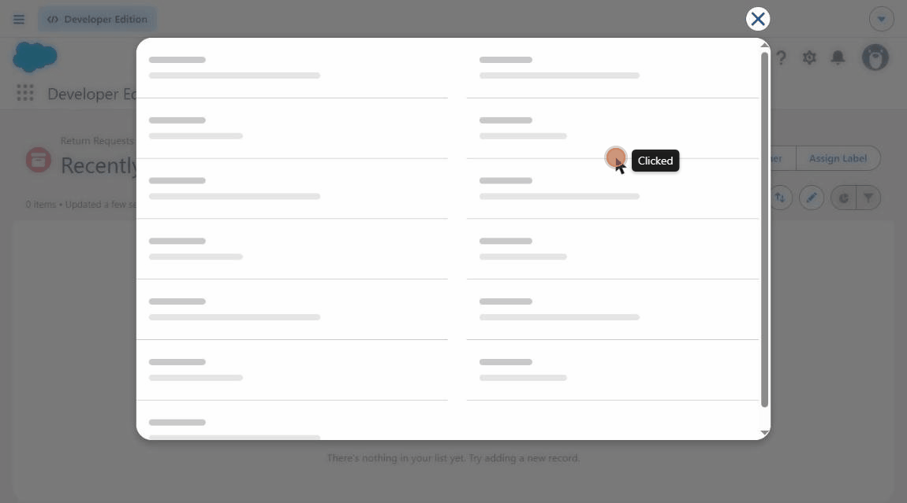
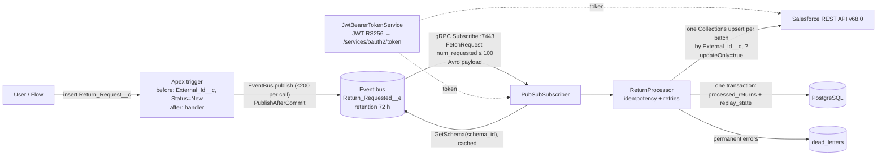

# sf-returns-sync-java

**A return request created in Salesforce gets its decision back in about a second — through a Java service
instead of MuleSoft.**



<sub>Recorded on the live Developer Edition: `DEMO-2042` created at 23:51:35 UTC, set to `Approved` at 23:51:36 by
the integration user — the service was running in a Docker container on GitHub Actions at the time
(the `live-load` workflow). The trigger sets `New` on insert; the page already loads the service's answer.</sub>

## In one minute

- **What.** Someone creates a *Return Request* in Salesforce. A small Java service hears about it, decides
  `Approved` / `Rejected` / `Manual_Review` (a simple amount rule), and writes the status back to the record.
- **Why.** It is the job companies usually build with MuleSoft's Salesforce connector, done by hand to show what
  happens inside: event streaming, resuming after a crash, never processing an event twice, retrying only what is
  worth retrying, parking bad messages. A portfolio project, small enough to explain line by line.
- **How.**

  ```
  Salesforce                                   Java service (Spring Boot 4.1, Java 25)          PostgreSQL
  ──────────                                   ───────────────────────────────────────          ──────────
  record inserted ─► Apex trigger ─► Platform ─► Pub/Sub API (gRPC + Avro) ─► decide status ─► results,
                                     Event bus                                     │            replay position,
  record updated  ◄──────────── batched REST upsert by External ID ◄───────────────┘            dead letters
  ```

  The service logs in with OAuth 2.0 JWT Bearer, remembers its position in the event stream (the *replay ID*) in
  PostgreSQL in the same transaction as the results, and picks up exactly where it stopped after a crash.
- **Proof, on a live Salesforce Developer Edition.** 1,200 events under load: 1,200 statuses, **0 duplicates,
  0 errors**; every record of a burst of 100 has its status within **2–6 s** (p95); the Docker container peaked
  at **183 MiB of its 384 MiB** limit during an hour of load ([Load test results](#load-test-results)). CI runs
  the tests (Java and LWC Jest), starts the Docker image and validates the Apex code against the org on every push.
- **Stack.** Java 25 · Spring Boot 4.1 · gRPC + Avro (Salesforce Pub/Sub API) · PostgreSQL + Flyway · Docker ·
  GitHub Actions · Apex / SFDX · JUnit 5, Mockito, Testcontainers, WireMock.

Try it yourself: [docs/ORG_SETUP.md](docs/ORG_SETUP.md) (free Developer Edition, about an hour). What was checked
and how: [What is verified and what is not](#what-is-verified-and-what-is-not).

## What it does

1. A `Return_Request__c` record is created in Salesforce (UI, Flow, API).
2. A thin Apex trigger fills `External_Id__c` / `Status__c = New` and publishes `Return_Requested__e`
   (High Volume, Publish After Commit) with one `EventBus.publish` per trigger batch.
3. The Java service subscribes via the Pub/Sub API (`api.pubsub.salesforce.com:7443`), decodes the Avro payload,
   decides `Approved` / `Rejected` / `Manual_Review`, and calls
   one `PATCH /services/data/v68.0/composite/sobjects/Return_Request__c/External_Id__c?updateOnly=true` per
   `FetchResponse` (up to 100 events, ≤ 200 records per call).
4. The result and the replay ID are committed in **one PostgreSQL transaction**. Permanent errors go to
   `dead_letters` (also together with the replay ID). Transient errors are retried, then the stream restarts
   from the last saved replay ID.

## Architecture



```
sf-returns-sync-java/
├── salesforce/                      SFDX project
│   ├── package.json, jest.config.js         Jest tooling for the LWC tests (Node range: `engines` in `package.json`)
│   ├── .forceignore                         keeps `__tests__` and local editor/lint config out of deploys
│   └── force-app/main/default/
│       ├── objects/Return_Request__c/      External_Id__c (External ID, unique), Status__c, Order_Number__c, Amount__c
│       ├── objects/Return_Requested__e/    HighVolume, PublishAfterCommit
│       ├── triggers/ReturnRequestTrigger   thin trigger
│       ├── classes/ReturnRequestTriggerHandler(+Test)   bulk test on 200 records
│       ├── lwc/returnSyncStatus(+__tests__)             record-page component showing the sync status; Jest tests
│       ├── flexipages/Return_Request_Record_Page        record page that places the component
│       └── permissionsets/   Return_Sync_Integration (service user), Return_Request_Manager (people)
├── service/                         Maven, Spring Boot 4.1, Java 25
│   ├── src/main/proto/pubsub_api.proto      copy from forcedotcom/pub-sub-api (CC0), byte-identical
│   └── src/main/java/io/github/albert/returnsync/
│       ├── auth/        JwtBearerTokenService, SalesforceToken
│       ├── pubsub/      PubSubSubscriber, SalesforceCallCredentials
│       ├── processing/  ReturnEvent, ReturnPolicy, ReturnProcessor
│       ├── salesforce/  SalesforceRestClient, Transient/PermanentSalesforceException
│       ├── store/       ReturnStore (JdbcClient, Flyway migration V1__init.sql)
│       └── config/      SalesforceProperties
├── docs/ORG_SETUP.md, docs/LOAD_TEST.md   live-org setup, first-run checklist, load test
├── scripts/                         load-test.sh + load-test.apex, load-test-cleanup.apex, measure-memory.sh
├── docker-compose.yml               postgres:17-alpine + service (mem_limit 384m)
└── .github/workflows/ci.yml         mvn verify, docker smoke run, LWC Jest tests, Apex validation
```

No `interface` + `Impl`, no mappers, no DTO layers: nine production classes in five packages.

## Built on the official sample

Salesforce officially supports only the Java samples of the Pub/Sub API: the *Java Quick Start* and the `java`
folder of [`forcedotcom/pub-sub-api`](https://github.com/forcedotcom/pub-sub-api). The repository is archived
(read-only), but the docs still point to it. Taken from it as is:

- `pubsub_api.proto` and stub generation by the Maven protobuf plugin during the build;
- the `StreamObserver` pull subscription, the next `FetchRequest` when `pending_num_requested == 0`;
- replay ID as `ByteString` / bytes, presets LATEST / CUSTOM / EARLIEST;
- `GetSchema` by `schema_id` + a schema cache (`ConcurrentHashMap`), Avro `GenericRecord`;
- auth metadata `accessToken` / `instanceUrl` / `tenantId` on every call (`APISessionCredentials.java`);
- error handling via the `error-code` trailer: `fetch.replayid.corrupted` / `fetch.replayid.validation.failed` → EARLIEST.

Added on top (what a sample skips and a production service needs): OAuth 2.0 JWT Bearer instead of
username/password, replay ID in PostgreSQL instead of process memory, idempotency, dead letters, retries of
transient errors only, one transaction "result + replay ID", `SmartLifecycle` with graceful shutdown,
reconnect with backoff + jitter, Docker, CI, tests.

## Integration patterns covered

Names from Salesforce *[Integration Patterns and Practices](https://developer.salesforce.com/docs/atlas.en-us.integration_patterns_and_practices.meta/integration_patterns_and_practices/integ_pat_intro_overview.htm)*
(checked against the Winter '27, v68.0 PDF):

- **Remote Process Invocation — Fire and Forget**, process-driven platform events: Salesforce publishes and does
  not wait. The guide: platform events are published once, there is no retry on the Salesforce side, the
  subscriber requests a replay, and "the replay ID remains the same", so duplicates can be detected.
- **Remote Call-In**: the external service updates Salesforce through the REST API.
- **Idempotent design.** This is *not* a separately named pattern in the guide. Each pattern has an
  "Idempotent Design Considerations" section; Request and Reply says "the most typical method of building an
  idempotent receiver is for it to track duplicates based on unique message identifiers" and recommends an
  upsert. *Idempotent Receiver* as a pattern name comes from Hohpe & Woolf, *Enterprise Integration Patterns*.
  Here: at-least-once delivery + dedup on `External_Id__c` (`processed_returns`) + the upsert itself is
  idempotent (same status for the same External ID). The dedup key is the business key, not the replay ID,
  so a re-published event for the same request is also caught.

## Protocol rules and where the code enforces them

| Rule (Pub/Sub API docs) | Where |
|---|---|
| `num_requested` ≤ 100 | `SalesforceProperties` rejects `batch-size` outside 1..100 at startup; default 100 |
| After `pending_num_requested == 0`, send a new `FetchRequest` within 60 s | `PubSubSubscriber.handle` sends it **before** processing the batch, so the deadline doesn't depend on REST latency |
| Keepalive (empty `FetchResponse`) carries `latest_replay_id`: store it | `handle` → `ReturnStore.saveReplayId` |
| While events are requested the server answers at least every 270 s | idle watchdog: no `FetchResponse` for 300 s (`salesforce.stream-idle-timeout`) → cancel and resubscribe (found by the live load test) |
| Replay ID is opaque bytes | `BYTEA` column, `ByteString` end to end, never converted |
| Replay option is read only in the first `FetchRequest` of a stream | `subscribe()`: CUSTOM with stored ID, else LATEST |
| Replay ID older than 72 h or corrupted (`...replayid...` error code) | next subscribe uses EARLIEST; idempotency drops the duplicates |
| `...auth.error` / `UNAUTHENTICATED` | drop the cached token, reconnect, a new JWT is signed |
| Any stream error → call `Subscribe` again | `reconnectLater()`: backoff 1 s → 64 s cap + jitter; a `generation` counter ignores callbacks of old streams |

## Design decisions & trade-offs

- **Idle watchdog.** A dead TCP connection can leave a gRPC stream open with nothing arriving and no error. The
  keepalive guarantee (≤ 270 s) gives a safe timeout: 300 s of silence → resubscribe from the stored replay ID.
- `Subscribe` + client-side replay store instead of `ManagedSubscribe` (beta): with plain `Subscribe` the replay
  store is the client's responsibility, which is exactly the part worth showing.
- **One worker thread.** gRPC calls `onNext` on its network thread, which must not block; everything goes to
  `pubsub-worker`. Strict ordering, and only one thread touches the request `StreamObserver` (it is not thread-safe).
- **Next `FetchRequest` before processing.** The official sample notes this for slow processing. At most one
  extra batch waits in the worker queue (the next request is only sent when the worker gets to a response).
  If one batch ever takes longer than 60 s, the server closes the stream and the service resumes from the stored
  replay ID — slower, not lossy.
- **One Salesforce call per `FetchResponse`** (sObject Collections upsert, `allOrNone=false`): first measured with
  one PATCH per event — p95 34 s for a burst of 100 — then batched: p95 1.9 s (see [Load test results](#load-test-results)).
  `updateOnly=true` works per record in Collections (an unknown External ID → `NOT_FOUND`, nothing created; checked
  live). Trade-off found live: Collections carries `External_Id__c` in each record body, so the integration user
  needs **edit** on that field (`INVALID_FIELD_FOR_INSERT_UPDATE` otherwise). Single-record upsert or a Composite
  request of single upserts (≤ 25 per call) would avoid that permission at the cost of more calls.
- **REST call outside the DB transaction**; results + dead letters + replay ID in one transaction (`@Transactional` on a public
  method of a separate bean, so the proxy works).
- **Retries only for transient errors**: 429, 5xx, I/O, `REQUEST_LIMIT_EXCEEDED`, and a 401 that survives one token
  refresh (a credentials problem is not the message's fault; it must not dead-letter every event). 3 attempts,
  0.5 s → 1 s. After that the stream restarts from the last saved replay ID: events stay on the bus for 72 h.
- **Permanent errors** (e.g. `NOT_FOUND`, unknown External ID with `updateOnly`) → `dead_letters` + replay ID advances.
  Exception: if **every** record of a call fails with a permission/configuration error
  (`INVALID_FIELD_FOR_INSERT_UPDATE`, `INSUFFICIENT_ACCESS_*`, …) it is treated as transient — a missing field
  permission once dead-lettered a whole live batch; now the events wait on the bus until the permission is fixed.
- **Poison messages**: an event whose Avro payload can't be decoded goes to `dead_letters` instead of restarting
  the stream forever. A failure to *fetch* the schema is transient and restarts the stream.
- `REQUEST_LIMIT_EXCEEDED` (15,000 REST calls / 24 h in Developer Edition) is treated as transient. Retries won't
  fix it quickly, but the replay ID doesn't move and the backoff grows, so nothing is lost within 72 h.
- `tenantid` = org ID, parsed from the `id` URL of the token response. A common approach; the JWT article doesn't
  spell it out. Alternative: call the identity URL.
- JDK `HttpClient` instead of Spring `RestClient`, JDK `Signature` instead of Nimbus/jjwt: no extra dependencies,
  and the JWT code follows the Help article step by step (~30 lines).
- No web server, no JPA, no Kafka, no Resilience4j: three tables and one stream don't need them.

## Limits considered (Developer Edition)

From the official *Platform Events Developer Guide* and *Salesforce Developer Limits and Allocations Quick
Reference*, v68.0 (Winter '27):

| Limit | Value | How the design respects it |
|---|---|---|
| Event delivery to Pub/Sub API / CometD / empApi / relays | 10,000 / 24 h (rolling, shared by all API subscribers; Apex triggers and flows don't count) | small org volume; one subscriber |
| Event publishing | 50,000 / hour | one `EventBus.publish` per trigger batch |
| REST API requests | 15,000 / 24 h (Total Calls Per 24-Hour Period) | one Collections call per batch of up to 100 events; no polling |
| High-volume event retention | 72 h | replay store; EARLIEST fallback |
| `num_requested` | ≤ 100 | 25 |
| Next `FetchRequest` | within 60 s after pending = 0 | sent before processing |
| Keepalive | ≤ 270 s | replay ID from empty responses is saved |

## How this maps to MuleSoft

| This repo | MuleSoft |
|---|---|
| `PubSubSubscriber` | Salesforce Pub/Sub Connector — *Subscribe channel listener* |
| `replay_state` table | Replay option *Replay id from object store* + Object Store |
| `salesforce.batch-size` (`num_requested`) | *Batch events size* (max 100 — same limit) |
| `ReturnProcessor.callWithRetry` | *Until Successful* scope |
| Transient vs permanent exception | *On Error Continue / On Error Propagate* by error type |
| `dead_letters` table | DLQ (e.g. Anypoint MQ dead-letter queue) |
| `processed_returns` dedup | *Idempotent Message Validator* |
| `SalesforceRestClient.updateStatus` | Salesforce Connector *Upsert* |
| `JwtBearerTokenService` | Salesforce Connector *OAuth JWT* connection |
| `application.yml` + env vars | Properties files + secure properties |

## Run locally

Prerequisites: a Developer Edition org, Salesforce CLI (`sf`), Docker, JDK 25 (only for running tests outside Docker).
The short version is below; [docs/ORG_SETUP.md](docs/ORG_SETUP.md) has every step, the key/certificate commands,
a JWT login check with the CLI, a first-run checklist and troubleshooting.

1. Deploy metadata:
   `cd salesforce && sf project deploy start --source-dir force-app --target-org <alias>`
2. Create an integration user and assign the `Return_Sync_Integration` permission set.
3. Create an External Client App: enable OAuth, *Enable JWT Bearer Flow*, upload the certificate (`server.crt`).
   In the policies choose *Admin approved users are pre-authorized* and select the `Return_Sync_Integration`
   permission set.
4. `cp .env.example .env`, fill in `SF_CLIENT_ID` and `SF_USERNAME`. Put the private key into
   `secrets/sf_jwt_key.pem` in **PKCS#8** (`BEGIN PRIVATE KEY`). If you have `BEGIN RSA PRIVATE KEY`:
   `openssl pkcs8 -topk8 -nocrypt -in server.key -out secrets/sf_jwt_key.pem`.
   `.env`, `secrets/`, `*.key`, `*.pem` are git-ignored; the key is mounted read-only, never baked into the image.
5. `docker compose up --build`
6. Create a `Return_Request__c` record and watch its `Status__c` change.

Tests: `cd service && ./mvnw verify` (Testcontainers integration tests need Docker and are skipped without it).

## Tests

| Test | What it proves | Needs |
|---|---|---|
| `ReturnProcessorTest` (JUnit 5 + Mockito, parameterized) | business rule, duplicate skip, retry of transient only, dead letter for permanent | — |
| `PubSubSubscriberTest` (in-process gRPC fake of the Pub/Sub API) | first request LATEST/CUSTOM with `num_requested`, auth headers, keepalive replay saved, next request sent while a batch is still processing, `replayid` error → EARLIEST, auth error → token dropped, poison event → dead letter, transient failure → resubscribe from saved replay | — |
| `SalesforceRestClientTest` (WireMock, response bodies as the live org returns them) | Collections URL, `updateOnly=true`, request body, results in order, `NOT_FOUND` per record, >200 records split into calls, 401 → one retry with a fresh token, 5xx / 429 / `REQUEST_LIMIT_EXCEEDED` / `UNABLE_TO_LOCK_ROW` transient, whole-batch permission error transient, 400 permanent | — |
| `JwtBearerTokenServiceTest` (WireMock) | RS256 signature verifies with the public key, claims `iss/sub/aud/exp ≤ 180 s`, org ID parsing, caching and invalidation | — |
| `WiringTest` | Boot 4 exposes the Jackson 3 `tools.jackson.databind.json.JsonMapper` bean; `batch-size > 100` rejected | — |
| `ReturnStoreIT` (Testcontainers PostgreSQL 17) | full Spring context with Flyway, `ON CONFLICT DO NOTHING`, replay ID bytes round-trip unchanged, dead letter + replay in one call | Docker |
| `ReturnRequestTriggerHandlerTest` (Apex) | 200 records in bulk → 200 events, defaults assigned | an org (CI job `apex`, needs secrets) |
| `returnSyncStatus.test.js` (LWC Jest, 61 tests) | the record-page component's rendering and behaviour against local stubs | Node range in `salesforce/package.json` (`engines`); no org (CI job `lwc`) |
| CI `docker-smoke` | image builds, compose stack starts, Flyway migrates real Postgres, service stays up (no org: reconnect loop), not OOM-killed under 384 MB, graceful stop | Docker |

## What a Java reviewer will check

- The gRPC thread is never blocked in `onNext` — work goes to the `worker`.
- Only one thread writes to `requestStream` (`StreamObserver` is not thread-safe).
- `ManagedChannel` is closed (`shutdown` → `awaitTermination` → `shutdownNow`); graceful shutdown via `SmartLifecycle`.
- `@Transactional` on a public method of a separate bean, not a self-call; no transaction held during the HTTP call.
- `InterruptedException` restores the interrupt flag.
- Secrets are not in code or in the image: the key is mounted read-only.
- No infinite retries, no retries of permanent errors, no endless restart on a poison message.
- Tests check behaviour, not implementation; at least one test runs against a real database.

## What a Salesforce reviewer will check

- No SOQL/DML in loops; one `EventBus.publish` per batch.
- A bulk test on 200 records with `Test.startTest/stopTest`.
- Logic in the handler, not in the trigger; `with sharing`.
- `SaveResult` is checked, not "fire and pray".
- Why `PublishAfterCommit`: the event is not sent if the transaction rolls back.
- Why the trigger is insert-only: the service updates `Status__c`, an update trigger would publish again (recursion).
- Least privilege: a dedicated permission set, a pre-authorized External Client App, an integration user, not an admin.
- No `.sf/`, keys or `.env` in the repository.

## What is verified and what is not

Verified:

- `mvn verify` passes locally on JDK 25.0.5 (Temurin) + Maven 3.9.16 (33 unit/in-process tests; the 4
  Testcontainers tests are skipped on a machine without Docker) and in GitHub Actions, where all 4
  Testcontainers tests run against PostgreSQL 17 and pass.
- The Docker image builds and the compose stack starts in CI: Flyway migrates, the full Spring context comes up
  with the production config, the service stays up in its reconnect loop under the 384 MB limit without
  restarts or OOM kill, and stops gracefully. The smoke run found a real bug (jitter was added after the 60 s
  backoff cap, giving a 74.7 s delay); fixed and covered by a test.
- First-build checks from the plan:
  - `protoc` = `protobuf-java` = **3.25.9**: `mvn dependency:tree` shows `grpc-protobuf 1.85.1 → protobuf-java 3.25.9`
    (the plan had 3.25.8, which would not match). The version is also pinned in `dependencyManagement`.
  - Spring Boot 4 starters `spring-boot-starter-jdbc`, `-flyway`, `-jackson`, `spring-boot-testcontainers` resolve (4.1.2).
  - Testcontainers 2.x: artifacts `testcontainers-junit-jupiter` / `testcontainers-postgresql` 2.0.5,
    class `org.testcontainers.postgresql.PostgreSQLContainer` (not generic).
  - Jackson 3 bean type: `tools.jackson.databind.json.JsonMapper` (Jackson 3.1.x); annotations stay in
    `com.fasterxml.jackson.annotation`.
  - `org.apache.tomcat:annotations-api` from the plan is not needed: grpc-java 1.85.1 generates
    `@io.grpc.stub.annotations.GrpcGenerated`, the build compiles without it.
- **Salesforce part in a live Developer Edition** (Winter '27, API 68.0, 2026-11-10): `sf project deploy start
  --test-level RunLocalTests` succeeds (14 components), Apex tests 2/2 pass, coverage trigger 100%, handler 90%,
  org-wide 91%. A record created with `sf data create record` gets a UUID `External_Id__c` and `Status__c = New`.
  `scripts/load-test.apex` and `scripts/load-test-cleanup.apex` compile and run. `sf limits api display` shows the
  Developer Edition limits used below (15,000 API requests, 10,000 deliveries, 50,000 publishes/h, 5 MB data).
- **Java service against the live org** (2026-11-11, service run with `java -jar` + local PostgreSQL 17.11,
  same JVM flags as the image; no Docker on that machine):
  - JWT Bearer login through the External Client App (own ~30-line client) and `tenantid` from the token's `id` URL work;
  - `Subscribed ... with preset LATEST`; two records created → `ORD-100` (120) `Approved`, `ORD-101` (900)
    `Manual_Review`, about 1–3 s from insert to status (Salesforce `CreatedDate` has 1 s resolution);
  - the real Avro schema of `Return_Requested__e` decodes with `ReturnEvent.from`; `updateOnly=true` upsert works;
  - the replay ID Salesforce sends is **29 bytes and not a number** (it contains an ASCII cluster name) — the
    reason it is stored as `BYTEA` and never converted;
  - service killed (no graceful stop), two records created while it was down, restarted → `preset CUSTOM`, both
    processed, `processed_returns` rows = distinct IDs;
  - replay ID overwritten with `\x00` → server answers `INVALID_ARGUMENT`,
    `error-code=sfdc.platform.eventbus.grpc.subscription.fetch.replayid.corrupted` → resubscribe with `EARLIEST`
    → already processed events logged as `Duplicate ..., skipping`, nothing processed twice;
  - the same EARLIEST replay delivered an event for a record deleted earlier → REST `404 NOT_FOUND` → one row in
    `dead_letters`, the stream went on.
- The first live deploy found a real problem: deployed custom fields get no field-level security on profiles, so the
  tests failed with `DmlException: fields being inaccessible` and even the admin couldn't write the fields. Fixed by
  the `Return_Request_Manager` permission set and tests that `System.runAs` a user who has it.
- `pubsub_api.proto` is byte-identical to the one in `forcedotcom/pub-sub-api` (root and `java/src/main/proto`).
- Versions differ from the official sample's `pom.xml` on purpose (it has Java 11, grpc 1.64.0, protoc 3.25.3,
  Avro 1.11.0); this repo uses current releases: grpc 1.85.1, protobuf 3.25.9, Avro 1.12.2, WireMock 3.13.2.

- **Load test against the live org** (2026-11-11, 12 rounds x 100 records every 5 min via `scripts/load-test.sh`,
  1,200 events; see [Load test results](#load-test-results)): every record got a status, 0 duplicates, 0 errors;
  it also found the silent-stream problem below, fixed by an idle watchdog.
- **Integration user**: `returns-integration@...` (Salesforce Integration licence, profile *Minimum Access - API Only
  Integrations*, permission set licence `SalesforceAPIIntegrationPsl`, permission set `Return_Sync_Integration`)
  logs in with JWT and processed 1,000 of the load-test events; Salesforce shows it as *Last Modified By*.
- **`apex` CI job** with the repository secrets: JWT login, `sf project deploy validate --test-level RunLocalTests`,
  18/18 components, Apex tests 2/2 — green on every push to `main`.

**Caveats:**

- One service instance per topic (strict order, one replay store); horizontal scaling is not designed.
- Spring Boot support dates (4.0.x OSS until 2026-12-31, 4.1.x until 2027-07-31) come from a third-party review
  (AceMQ, compared with spring.io on 2026-10-22), not from spring.io directly.

## Load test results

### Final: the Docker image against the live org

[`live-load` run](https://github.com/a-kamalov781/sf-returns-sync-java/actions/runs/42922659862) on GitHub Actions, 2026-11-11, final code (batched write-back, idle watchdog): the
`docker compose` stack (service `mem_limit: 384m`, PostgreSQL 17) against the live Developer Edition, the service
logged in as the integration user; `scripts/load-test.sh` 12 rounds x 100 records every 5 minutes;
`scripts/measure-memory.sh` sampled `docker stats` every minute for 60 minutes.

| Metric | Value |
|---|---|
| Records that got a status | **1,200 / 1,200** (900 `Approved`, 300 `Manual_Review`) |
| Duplicates / dead letters / container restarts / OOM kills | **0 / 0 / 0 / 0** |
| Container memory over 60 min (`docker stats`) | min 166 MiB, avg 178 MiB, **max 183 MiB of 384 MiB (48%)** |
| End-to-end latency, insert → status in Salesforce (1,200 events in bursts of 100) | **p50 2.4 s, p95 5.8 s**, max 5.8 s |
| API requests for the whole run, load-script CLI calls included | **55** (one PATCH per event used ~1,300 for the same load) |
| Graceful stop (`docker compose stop -t 30`) | **0.44 s** |
| Warnings in the service log | 1: after ~58 min the server rotated the connection (`GOAWAY`, `NO_ERROR`); reconnected in 1 s with `CUSTOM`, nothing lost |

Latency here is measured from GitHub's runner and uses Salesforce `CreatedDate`, which has 1 s resolution.

### How it got there

The first one-hour run used `java -jar` on Windows (no Docker on that machine) with one REST PATCH per event. It
found two real problems — a silently dead stream and a 34 s p95 for a burst — fixed below, and the numbers above
are after both fixes.

Live Developer Edition, 2026-11-11, first run. `scripts/load-test.sh`: 12 rounds, each one anonymous-Apex insert of 100
`Return_Request__c` (two `EventBus.publish` calls of up to 200), every 5 minutes, 1,200 events in total. Service:
`java -jar` with the image's JVM flags (`-Xmx269m` = 70% of 384 MB, SerialGC), local PostgreSQL 17.11.

| Metric | Value |
|---|---|
| Records that got a status | **1,200 / 1,200** (900 `Approved`, 300 `Manual_Review`, 0 left `New`) |
| Duplicates processed | **0** (`processed_returns`: 1,205 rows = 1,205 distinct External IDs) |
| Errors / retries / dead letters from the run | **0** (the one `dead_letters` row is the earlier deliberate 404 test) |
| Throughput, one worker, one REST PATCH per event | **3.4 events/s** (1,000-event backlog drained in 4 min 55 s) — before batching |
| End-to-end latency, burst of 100 (insert → status in Salesforce) | min 1.3 s, **p50 18.9 s, p95 33.7 s**, max 35.3 s (200 events, rounds 1–2) — before batching; batched: p50 1.2 s, p95 1.9 s |
| Single event, no queue | ~1–3 s |
| Memory (Windows working set) | peak **250 MiB**; heap used ≤ 71 MiB of 269 MiB; 23–36 threads |
| API requests used | ~1,300 of 15,000 / 24 h (one PATCH per event + CLI calls) — before batching |

Latency under a burst is queueing: events are processed one by one in replay order, ~0.3 s per REST call, so the
100th event of a burst waits ~30 s. So the status write-back was changed to one sObject Collections upsert per
`FetchResponse` and measured again (live, 2 rounds x 100, integration user):

| Burst of 100, insert → status in Salesforce | one PATCH per event | **batched** |
|---|---|---|
| min | 1.3 s | **0.4 s** |
| p50 | 18.9 s | **1.2 s** |
| p95 | 33.7 s | **1.9 s** |
| max | 35.3 s | **2.3 s** |
| processed / dead letters | 200 / 0 | 200 / 0 |

The first batched run found the `External_Id__c` edit-permission requirement above: all 200 events were
dead-lettered with `INVALID_FIELD_FOR_INSERT_UPDATE`. After granting the permission they were re-driven by
resubscribing with EARLIEST: the 1,205 already processed were skipped as duplicates, the 200 were processed.

The memory "committed" by the JVM (Native Memory Tracking, ~370 MiB) is not usage: on a 16 GB Windows host the
default initial heap is 1/64 of RAM (~256 MB) and is reserved up front; inside the 384 MB container it is ~6 MB.

#### Found by the load test: a silent dead stream

After rounds 1–2 the service received **nothing** for 47 minutes: no events, no keepalives, no error, no
`onCompleted`; a thread dump showed the worker idle and the gRPC threads waiting. 1,000 records stayed `New`. The
connection had died without a reset, and nothing in gRPC tells the client about that by default.

Fix: an idle watchdog in `PubSubSubscriber`. While events are requested the server answers at least every 270 s
(a keepalive if nothing else), so no `FetchResponse` for `salesforce.stream-idle-timeout` (default 300 s) means a
dead stream: cancel, resubscribe from the stored replay ID. Covered by `silentStreamIsRestartedByTheIdleWatchdog`
and `keepalivesKeepTheWatchdogQuiet`. After the fix the service resumed with `CUSTOM` and drained the whole
backlog with no duplicates. Nothing was lost: the events waited on the bus (72 h retention).

## Measured

| Metric | Value | How |
|---|---|---|
| Container memory, live org, 1 h under load | **max 183 MiB / 384 MiB (48%)**, avg 178 MiB | `live-load`, `docker stats` every 60 s |
| Container memory, idle, no org | 150 MiB / 384 MiB | CI `docker-smoke`, after 90 s |
| End-to-end latency, burst of 100 | p50 1.2–2.4 s, p95 1.9–5.8 s (local run / GitHub runner) | `CreatedDate` vs `processed_at` |
| API requests per 1,200 events | 55 (batched) vs ~1,300 (one PATCH per event) | `sf limits api display` before/after |
| Graceful stop | 0.44 s with a live org, 0.4 s without | `docker compose stop -t 30` |
| Duplicates / errors under load | 0 / 0 | `processed_returns` rows = distinct IDs |

## Next steps

Nothing open for v1. Ideas for v2: a metric for replay lag (time between `CreatedDate` and processing), several
instances on one topic (`ManagedSubscribe` or partitioning), Composite single upserts if edit access to
`External_Id__c` is not acceptable.

## CI secrets (optional)

The `apex` job validates the deploy and runs local Apex tests (`sf project deploy validate`, nothing changes in
the org). It needs repository secrets `SF_CLIENT_ID`, `SF_USERNAME` (an admin: validation deploys Apex),
`SF_JWT_KEY`; without them the job is skipped with a notice. How to set them:
[ORG_SETUP §9](docs/ORG_SETUP.md#9-github-secrets-for-the-apex-ci-job).

## Not in v1 (on purpose)

Kafka/RabbitMQ/outbox (the event bus already is a queue with retention), Kubernetes and several replicas (one
subscriber per topic keeps order and replay simple), GraalVM native, JPA/MapStruct/Lombok, Spring Security OAuth2
Client for one JWT, Resilience4j for one retry loop, HTTP API/Actuator/metrics, `ManagedSubscribe`,
Change Data Capture, publishing from Java. Heroku AppLink is a different use case (calling Heroku apps from
Apex/Flow) and needs paid Heroku.

## License

`service/src/main/proto/pubsub_api.proto` is © Salesforce, CC0-1.0 (from `forcedotcom/pub-sub-api`).
